# Techistan — Full-Stack E-Commerce Platform

A production-deployed e-commerce platform: a customer storefront, a separate
admin console, and a NestJS REST API behind both of them. Built end to end —
schema, API, both frontends, payments, deployment — as a solo project.

| | |
| --- | --- |
| **Storefront** | [techistan.vercel.app](https://techistan.vercel.app) |
| **Admin console** | [techistanadmin.vercel.app](https://techistanadmin.vercel.app) |
| **API** | NestJS on Render · PostgreSQL on Neon |
| **Stack** | TypeScript, NestJS 11, Prisma 6, PostgreSQL, Next.js 16, React 19, Tailwind, Stripe, Cloudinary, Resend, Docker |
| **Status** | Deployed and running end to end (Stripe in test mode) |

> The two frontends are separate Next.js apps rather than one app with role
> branching, so the customer bundle never ships admin code, and each can be
> built, deployed and scaled independently.

```
Browser ──► Next.js storefront ─┐                  ┌─► Neon PostgreSQL (Prisma)
           (Vercel)             │                  │
                                 ├─► NestJS API ────┼─► Stripe (payments, webhooks)
Browser ──► Next.js admin ──────┘   (Render,        ├─► Cloudinary (media)
           (Vercel)                  Docker)        └─► Resend (transactional email)
```

Browsers never call the API host directly — each Next app proxies `/api/*` to
the API through a `next.config.ts` rewrite. That keeps the JWT auth cookies
first‑party, which matters: the two apps and the API started out on sibling
hosts, and `SameSite=Lax` cookies were silently dropped cross‑site. The
proxy fixed it without touching the backend.

---

## Screenshots

All screenshots below were taken against the **live deployed site**, signed
in as a seeded demo account, so the data (orders, revenue, reviews) is real
output of the running system rather than mockups.

### Storefront

| | |
| --- | --- |
| **Homepage** — hero carousel, category grid, curated product rails, all merchandising-driven (see the homepage builder further down) | 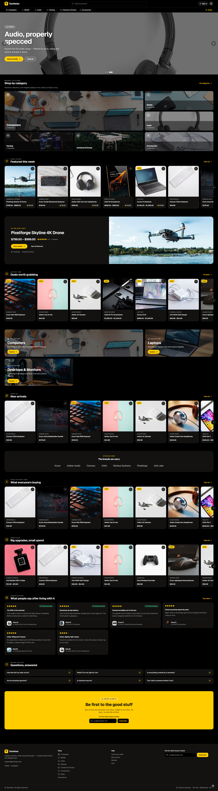 |
| **Category browsing** — breadcrumb, sub-category tiles, price range + sort, stock-aware grid | 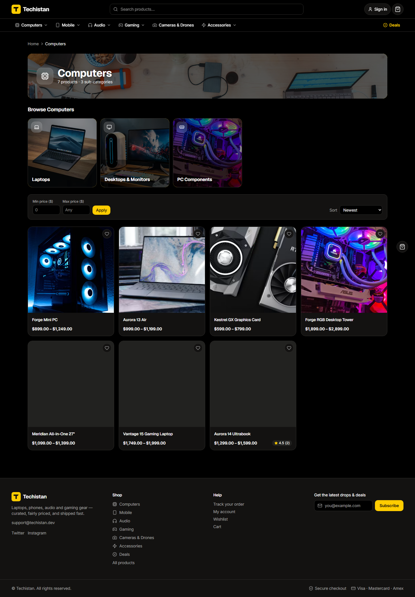 |
| **Product detail** — variant selectors, stock state, ratings/reviews, related products |  |
| **Search** — typo-tolerant full-text + trigram search, with the same filter/sort UI as a category page | 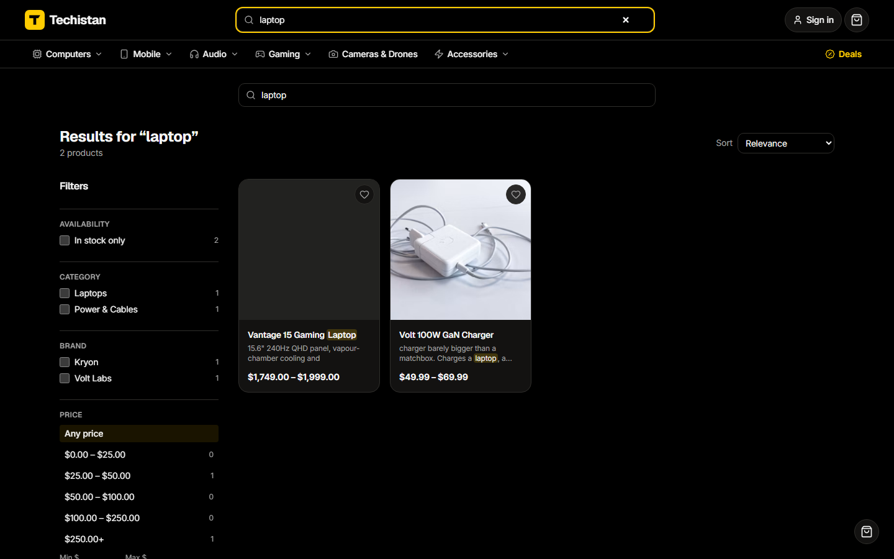 |
| **Deals** — time-boxed sale listing, independent of manual category curation | 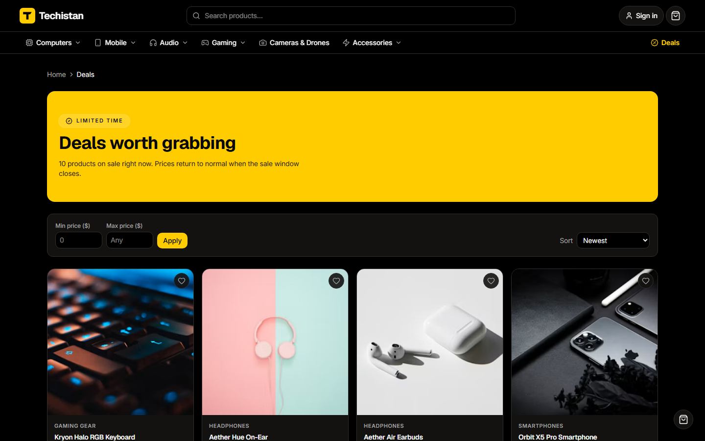 |
| **Cart** — line items, coupon code, shipping estimate, running total | 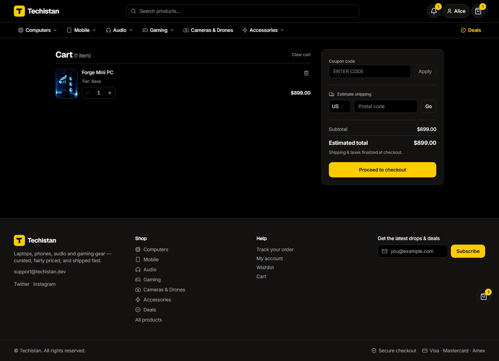 |
| **Checkout** — Stripe Payment Element (card, bank, Klarna), order summary carried through every step |  |
| **Order history** — every order with status, item count and total, filterable by status/date |  |
| **Order detail** — line items, discount/shipping/tax breakdown, downloadable PDF invoice, self-serve cancel | 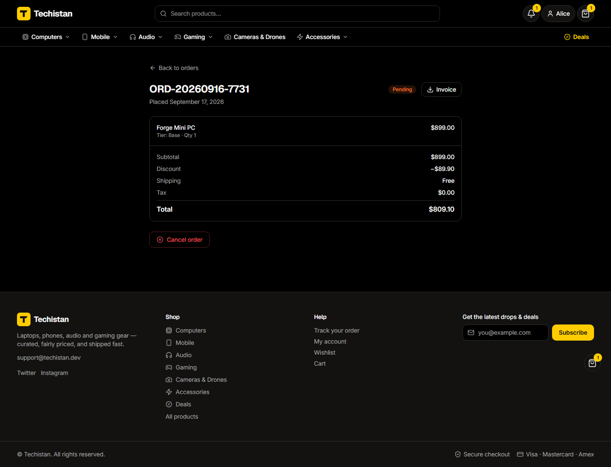 |
| **Wishlist** — saved items with one-click move-to-cart | 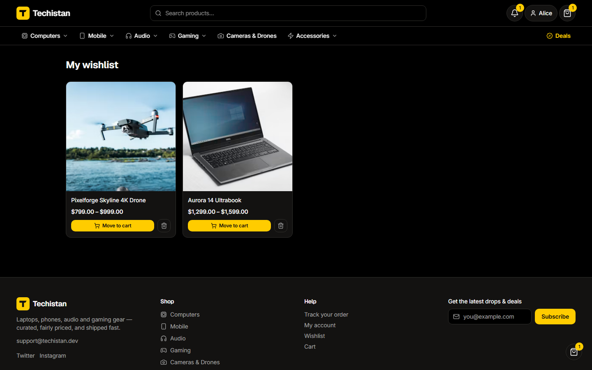 |
| **Notifications** — order confirmations, shipping updates, wishlist price-drop alerts | 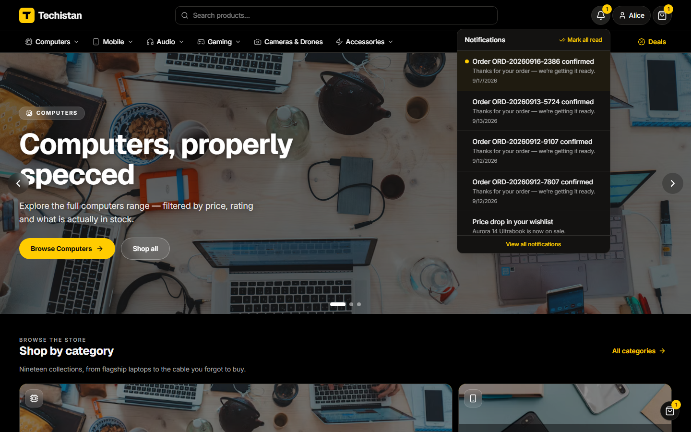 |

### Admin console

| | |
| --- | --- |
| **Dashboard** — revenue by range, conversion, average order value, low-stock and pending-review alerts |  |
| **Light theme** — full dark/light support via a shared brand-token system (`next-themes`) | 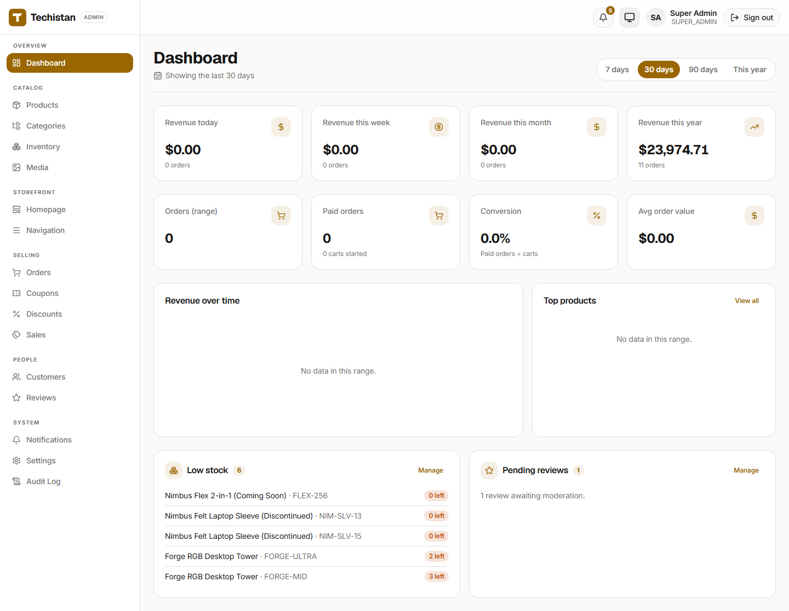 |
| **Products** — catalog table with status, price range and category, inline edit/duplicate/delete, CSV export |  |
| **Categories** — drag-to-reorder tree, up to 3 levels deep, product counts per node |  |
| **Orders** — searchable/filterable order queue across status and payment state | 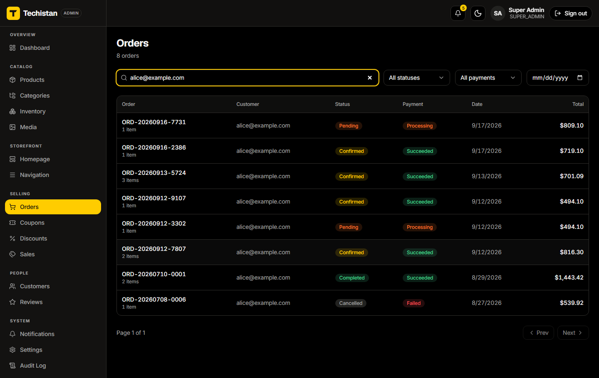 |
| **Order fulfillment** — status transitions, shipment tracking, internal notes, partial/full refunds | 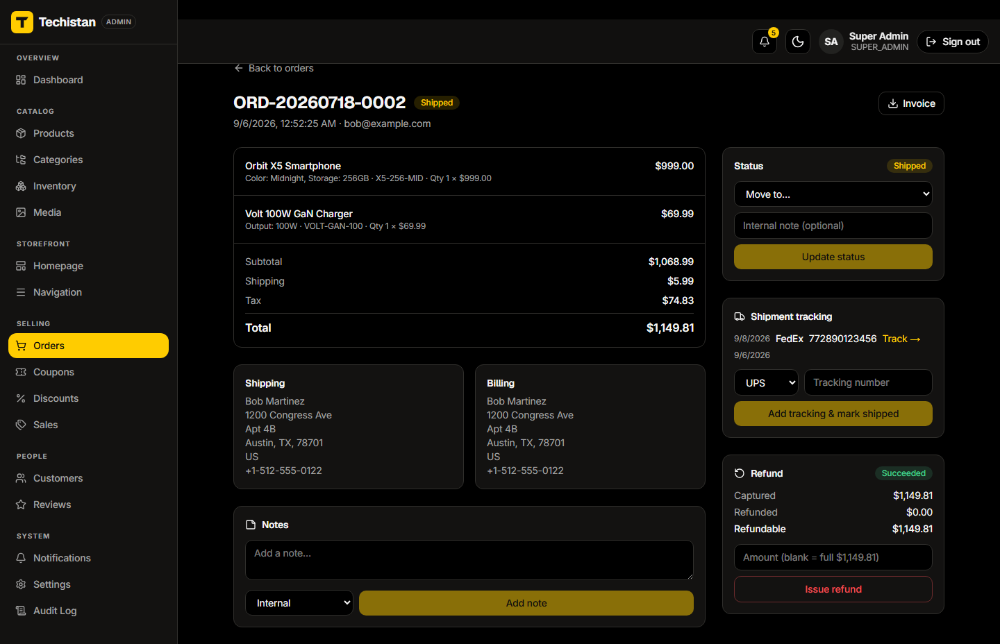 |
| **Coupons** — code-based discounts with usage caps, scopes and expiry windows | 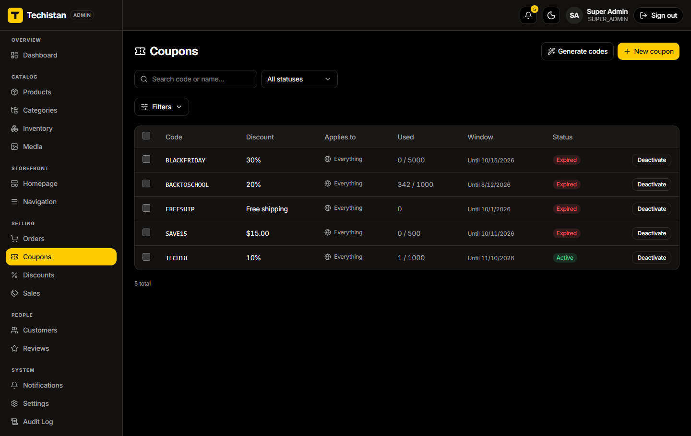 |
| **Homepage builder** — toggle, reorder and configure every storefront homepage block (hero slides, product rails, reviews, newsletter) without a deploy | 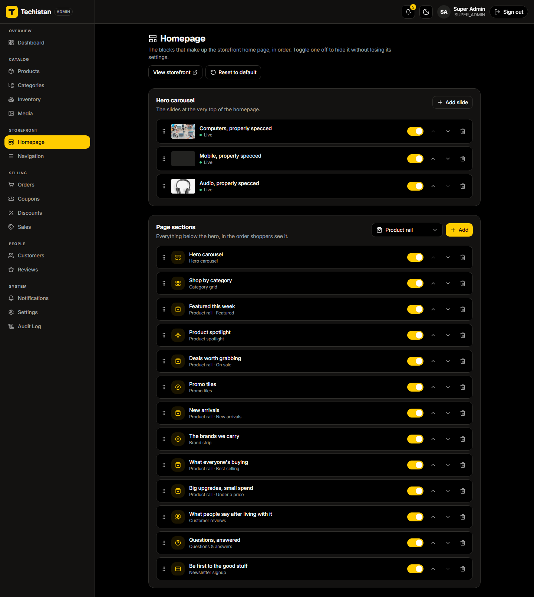 |
| **Review moderation** — approve/reject queue; approving recomputes the product's aggregate rating and writes an audit log entry | 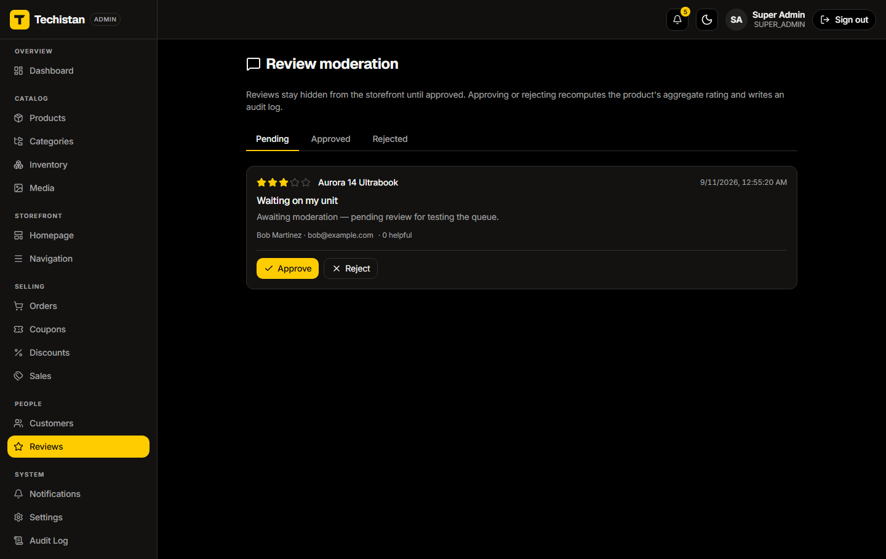 |

---

## Feature set

**Storefront**

- Catalog with categories, brands, tags, variants and per-variant stock
- Full-text and fuzzy search (Postgres trigram similarity), faceted filtering, sorting
- Guest and signed-in carts, with the guest cart merged into the account on login
- Wishlist, recently viewed, deals page, merchandising-driven dynamic homepage
- Stripe checkout (card / bank / Klarna), order confirmation, order history, PDF invoices
- Return requests, reviews with images and helpfulness votes
- Email verification, password reset, notification centre, GDPR account deletion

**Admin console**

- Dashboard with revenue and order analytics across configurable date ranges
- Products, variants, categories, tags, media library, bulk inventory editing
- Orders: status workflow, shipment events, internal notes, refunds, returns
- Coupons, automatic discounts, scheduled sales
- Review moderation queue, customer list, audit log, store settings
- Merchandising: homepage section builder, hero slides, navigation builder
- CSV exports for orders, customers and products

**Platform**

- Role-based access control (`CUSTOMER` / `ADMIN` / `SUPER_ADMIN`), request rate limiting, audit logging
- Stateless JWT access/refresh tokens in `httpOnly`, `Secure`, `SameSite=Lax` cookies; edge presence-check in Next middleware, authoritative check server-side against `GET /auth/me`, enforced by NestJS guards
- Signed-cookie guest sessions; idempotent order submission
- Cron jobs: hourly abandoned-cart recovery, nightly account anonymisation
- SEO: metadata API, `sitemap.ts`, `robots.ts`, JSON-LD; cookieless analytics
- One brand token file generates the CSS variables for both apps, including full dark mode

---

## Engineering notes

**Exactly-once payment confirmation, with a fallback.** A Stripe webhook
confirms the order, decrements stock, finalises coupon redemption and clears
the cart in one transaction, deduplicated by event id. Because a webhook can
be missing, misconfigured, or delivered to a sleeping free-tier instance, the
order endpoint also reconciles directly against the Stripe API while the
confirmation page polls. Both paths share one guard — a conditional status
update only one transaction can win — so stock is never decremented twice.

**Cross-site cookie failure in production.** Login worked, then every
following request returned 401. Cause: the API and the frontends were on
sibling `*.onrender.com` hosts — different *sites* — so `SameSite=Lax`
cookies were dropped. Fixed by proxying `/api/*` from each Next app to the
API, making the cookies first-party, with no backend change required.

**Postgres-backed search instead of a search service.** Trigram similarity
and ranked text matching behind a `SEARCH_DRIVER` switch, so search tolerates
typos without adding Elasticsearch to the deployment.

**Promotions engine.** Coupons and automatic discounts share a scope model
(whole cart, category, product) and are computed against the *eligible*
subtotal, with redemption limits enforced transactionally at payment time.

**Order lifecycle as a state machine.** Allowed transitions are declared in
one place and enforced server-side, so illegal jumps (e.g. `REFUNDED` →
`SHIPPED`) are impossible rather than merely hidden in the UI.

**Media handling without touching the server.** The browser uploads to
Cloudinary directly with a signed payload; the API only stores metadata, and
a custom `next/image` loader emits Cloudinary transformation URLs, so no
image bytes ever pass through the API.

---

## Tech stack

| Layer | Choices |
| --- | --- |
| **API** | NestJS 11, TypeScript, Passport JWT, class-validator DTOs, Joi-validated config, Throttler rate limiting, `@nestjs/schedule` cron |
| **Data** | PostgreSQL (Neon serverless), Prisma 6, SQL migrations, `pg_trgm` fuzzy search |
| **Frontends** | Next.js 16 (App Router, RSC), React 19, TanStack Query, Zustand, React Hook Form + Zod, Tailwind CSS, Framer Motion, next-themes |
| **Integrations** | Stripe (Payment Element + webhooks), Cloudinary (signed direct uploads), Resend + React Email, PDFKit invoices |
| **Testing** | Jest, Supertest, Vitest, Testing Library, Playwright, Lighthouse CI |
| **Infra** | Multi-stage Docker (Debian slim, non-root), Render blueprint (`render.yaml`), Vercel, GitHub |

**Scale:** ~55,600 lines of TypeScript across 490 files · 26 backend feature
modules, 35 controllers, 159 HTTP endpoints · 39 Prisma models, 16 enums, 15
migrations · 19 storefront routes, 25 admin routes · 213 unit tests (32
suites), 10 API integration specs, 7 Playwright E2E specs.

---

## Project structure

```
Code/
├── backend/            NestJS API (port 3000)
│   ├── src/modules/    26 feature modules (auth, catalog, cart, orders, payments, …)
│   └── prisma/         schema + migrations
├── frontend/
│   ├── user_client/    storefront, Next.js (port 3001)
│   └── admin_client/   admin console, Next.js (port 3002)
└── docker-compose.yml  Postgres + migrate + API, for local development
```

---

## Running it locally

```bash
cd Code
cp backend/.env.docker.example backend/.env.docker   # fill in the secrets
docker compose up --build
```

This starts three services in order: **db** (Postgres 17), **migrate**
(applies pending Prisma migrations, then exits), and **api** (NestJS on
`http://localhost:3000`, health check at `/health`). Then, from
`backend/`, seed some data:

```bash
docker compose run --rm seed                        # store settings + sample product + SUPER_ADMIN
docker compose run --rm seed npm run seed:demo       # full demo catalog + demo customers
```

Finally, run each frontend from its own directory:

```bash
cd Code/frontend/user_client  && npm install && npm run dev   # http://localhost:3001
cd Code/frontend/admin_client && npm install && npm run dev   # http://localhost:3002
```

Full environment-variable reference and a Render-specific deployment runbook
live in `Code/backend/README.md` and `Code/backend/DEPLOY-RENDER.md`.

---

## Testing

| Suite | Scope | Count |
| --- | --- | --- |
| Backend unit (Jest) | pricing, coupons, cart merge, order state machine, payments | 108 tests / 14 suites |
| Backend integration (Supertest) | auth, catalog, checkout and admin flows against the API | 10 specs |
| Storefront unit (Vitest + Testing Library) | components, hooks, formatting | 47 tests / 8 files |
| Admin unit (Vitest + Testing Library) | tables, forms, permissions | 58 tests / 10 files |
| E2E (Playwright) | browse → cart → checkout → order journeys | 7 specs |
| Performance (Lighthouse CI) | storefront budgets | configured |

TypeScript runs strict across all three apps, with ESLint and Prettier enforced.

---

## Deployment

- **API:** Docker image built from a Render blueprint (`render.yaml`), health
  check at `/health`, auto-deploy on commit, secrets held in the dashboard.
- **Frontends:** Vercel, with the API URL baked in at build time.
- **Database:** Neon serverless Postgres — pooled connection for the app,
  direct connection for migrations.
- **Seeding:** idempotent scripts for the admin account, catalog and a full
  demo dataset.

## Known limitations

- Runs on free tiers: the API spins down after 15 minutes idle and takes
  about a minute to wake, so the first request after a quiet period is slow.
- Stripe is in test mode; no live payments have been processed.
- The rate limiter is in-memory — correct for one instance, would need a
  shared store behind more than one.
- Migrations are run manually from a developer machine, since Render's
  pre-deploy hook requires a paid plan.
- No CI pipeline yet — tests run locally rather than on push.
